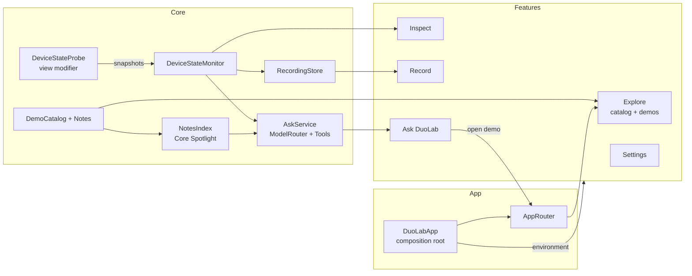

# DuoLab architecture

Status: target design for v1 · Last updated: 2026-11-11

Today the app is still the Xcode template (`DuoLabApp` + `ContentView`). This document describes the structure we are building toward; [ROADMAP.md](ROADMAP.md) says in what order.

## At a glance

- One iOS app target (`DuoLab`), SwiftUI, Swift 6, iOS 27.1+, iPhone only.
- Apple frameworks only: SwiftUI, UIKit (for UIKit demos), AVFoundation/AVKit (cameras), FoundationModels, CoreSpotlight.
- Three layers: **App** (composition), **Features** (screens), **Core** (models and services, no UI except one bridge modifier).
- The device's state flows one way: SwiftUI environment and Duo APIs → `DeviceStateProbe` → `DeviceStateMonitor` → Inspector, Recorder, Ask DuoLab, and demos.



## Folder layout

```
DuoLab/
  App/
    DuoLabApp.swift            composition root: builds models, injects them, attaches DeviceStateProbe
    AppRouter.swift            selected tab + Explore navigation path
    RootView.swift             TabView: Explore, Inspect, Record, Ask
  Features/
    Explore/                   CatalogView, DemoDetailView, NoteView, CodeSampleView
    Demos/
      Hinge/                   one folder per demo (see docs/DUO_APIS.md for the list)
      Arrangement/
      ReservedRegions/
      ...
    Inspect/                   InspectorView, ReservedRegionOverlay
    Record/                    RecorderView, RecordingListView, RecordingDetailView
    Ask/                       AskView, AnswerView, ModelBadge
    Settings/                  SettingsView
  Core/
    DeviceState/               DeviceSnapshot, DeviceStateMonitor, DeviceStateProbe, DisplayInference
    Catalog/                   DemoID, DemoEntry, DemoCatalog, NoteID, NoteStore
    Recording/                 Recording, RecordingEvent, RecordingSession, RecordingStore, Exporters
    Intelligence/              AskService, ModelRouter, Tools/, NotesIndex, KeywordSearch, SymbolCheck
    Shared/                    small helpers used by more than one Core area
  Resources/
    Notes/                     <note-id>.md, the knowledge base (format below)
    Assets.xcassets
DuoLabTests/                   Swift Testing unit tests for Core
DuoLabUITests/                 a few smoke tests (launch, open each demo)
scripts/                       verify-sdk-symbols.sh, sdk-symbols.txt
docs/
```

Rules:
- `Features/*` may import `Core`; features never reference each other. Navigation between them goes through `AppRouter`.
- `Core` holds no views, with one exception: `DeviceStateProbe`, because the Duo hinge and reserved-region APIs are only reachable from SwiftUI views.
- The whole app is one target for now (simple for learners to open and read). If Core tests get slow to run, move `Core` into a local Swift package; nothing in the layering would change.

## Composition and state

- `DuoLabApp` creates one instance each of `DeviceStateMonitor`, `DemoCatalog`, `RecordingStore`, `AskService`, `AppSettings` and `AppRouter`, and passes them down with `.environment(...)`.
- All are `@Observable` classes. With `SWIFT_DEFAULT_ACTOR_ISOLATION = MainActor` they are main-actor by default; slow work (indexing, file I/O, model calls) runs in `async` functions that leave the main actor explicitly (`@concurrent` / `nonisolated`).
- `AppSettings` wraps `UserDefaults` (allow Private Cloud, recorder angle threshold, last indexed notes hash).
- No singletons beyond the composition root. Previews build their own small instances (`.preview` factories).

## Device state

### Snapshot

`DeviceSnapshot` is a `Sendable`, `Codable`, `Equatable` value:

| Field | Source API | Notes |
|---|---|---|
| `hinge: HingeReading?` | `onHingeChange(isEnabled:_:)` → `DeviceHingeContext.hinge` (`DeviceHinge.status`, `.angle`) | `nil` means the device has no hinge |
| `windowSize` | `onGeometryChange` on the root view | points |
| `horizontalSizeClass`, `verticalSizeClass` | SwiftUI environment | |
| `interfaceOrientation` | `UIWindowScene.effectiveGeometry` | |
| `reservedRegions: [RegionReading]` | `GeometryProxy.reservedRegions(kind:options:layoutDirectionBehavior:)` for `.division` and `.occlusion`, with `.includeInactive` | frame, margins, kind, `isActive` |
| `toolbarVerticalEdge` | environment `toolbarVerticalEdge` | `nil` when bars are horizontal |
| `inferredDisplay` | `DisplayInference` | see below |
| `timestamp` | `ContinuousClock` + wall-clock `Date` | |

`HingeReading.status` mirrors `DeviceHinge.Status` (`closed`, `partiallyOpen`, `fullyOpen`) plus `unknown`, matching UIKit's `UIHinge.Status`. Angles are stored in degrees for readability.

### Probe → monitor

Hinge updates and reserved regions are SwiftUI view APIs, so a view has to collect them. `DeviceStateProbe` is a `ViewModifier` attached once, at the root of the window:

```swift
// Sketch. Verify every symbol with scripts/verify-sdk-symbols.sh before using it.
struct DeviceStateProbe: ViewModifier {
    @Environment(DeviceStateMonitor.self) private var monitor
    @Environment(\.horizontalSizeClass) private var horizontal
    @Environment(\.verticalSizeClass) private var vertical

    func body(content: Content) -> some View {
        content
            .onHingeChange { _, new in monitor.update(hinge: new.hinge) }
            .background {
                GeometryReader { proxy in
                    Color.clear
                        .onChange(of: proxy.size, initial: true) { monitor.update(geometry: proxy) }
                }
            }
            .onChange(of: horizontal, initial: true) { monitor.update(horizontal: horizontal) }
            .onChange(of: vertical, initial: true) { monitor.update(vertical: vertical) }
    }
}
```

`DeviceStateMonitor` merges these partial updates into the current `DeviceSnapshot` and publishes it. It also keeps a small in-memory change stream (an `AsyncStream<DeviceSnapshot>`) that the recorder consumes.

### Which display are we on?

The iOS 27.1 SDK has **no public API that says "inner" or "outer" display** (we checked the SwiftUI, UIKit and SwiftUICore interfaces). `DisplayInference` derives it and the UI always labels it as inferred:

| Condition | Result |
|---|---|
| `hinge == nil` | `.notFoldable` |
| hinge status `closed` | `.outer` |
| horizontal size class `regular` | `.inner` |
| anything else | `.unknown` |

If Apple adds a real API, replace the inference and record it in DECISIONS.

## Catalog and notes

- `DemoID`: a `String`-backed, `CaseIterable` enum with one case per demo (`hinge`, `arrangement`, `reservedRegions`, …). It is also `Generable`, so Ask DuoLab can only suggest demos that exist.
- `DemoEntry`: `id`, `title`, `summary`, `topic`, `symbols: [String]`, `frameworks`, `requiresDuo`, `verification`, `noteID`.
- `DemoCatalog.all` is a Swift array: type-checked, and it links metadata to the view factory (`DemoView(id:)` switches over `DemoID`).
- `NoteID` covers demo notes plus topic notes that aren't a demo (`device-overview`, `postures`, `size-classes`, `simulator-tips`). Note IDs are kebab-case; a demo's note ID is its `DemoID` in kebab-case (`reservedRegions` → `reserved-regions`).

### Note format

`Resources/Notes/<note-id>.md`, plain Markdown, no front matter (metadata lives in `DemoEntry`). Fixed sections so the app and the indexer can rely on them:

```markdown
# Hinge updates

## What it is
## How it behaves
## Code
## Gotchas
## Verified on
## Apple documentation
```

Notes are in our own words; link to developer.apple.com instead of quoting it. Each `##` section is one retrieval chunk for Ask DuoLab, so keep sections short and self-contained.

## Recorder

- `RecordingSession` subscribes to the monitor's change stream while recording and turns each snapshot difference into `RecordingEvent`s (`hinge`, `size`, `sizeClass`, `orientation`, `reservedRegions`, `toolbarEdge`, `marker`).
- **Throttling:** a hinge event is kept only if the angle moved at least the threshold (default 2°) since the last kept event, or the status changed. Other events are kept on every change.
- `Recording` (`Codable`): id, title, device model string, OS version, start date, events. Stored as `Application Support/Recordings/<id>.json`.
- Export: `Transferable` types for JSON and CSV, shared with `ShareLink`. Files use the `.duolab-recording.json` suffix (ignored by git so test exports don't get committed).

## Ask DuoLab

Summary here; the full design, including the prompt, is in [AI.md](AI.md).

- `NotesIndex` chunks notes by `##` section and indexes them into a private `CSSearchableIndex` named `DuoLabNotes`. It re-indexes when the hash of the bundled notes changes.
- `ModelRouter` chooses the on-device `SystemLanguageModel`, the opt-in `PrivateCloudComputeLanguageModel`, or keyword search.
- `AskService` runs a `LanguageModelSession` with tools for searching notes and reading device state, and generates a `Generable` answer that includes citations and suggested `DemoID`s.
- `SymbolCheck` flags any API name in an answer that isn't in the catalog's known symbols.

## Availability and degradation

| Situation | Behavior |
|---|---|
| Regular iPhone (no hinge) | Duo-only demos show an explainer; Inspector shows "no hinge" and `.notFoldable`; layout demos still run (they adapt to size class) |
| Inner/outer camera device types missing | Camera demos show the explainer; discovery returns no devices, so nothing crashes |
| Apple Intelligence off / device not eligible / model not ready | Ask shows the reason and falls back to keyword search |
| Private Cloud on but unavailable or out of quota | Falls back to on-device or keyword search; Settings shows quota status and reset date |
| Camera permission denied | Camera demos show how to enable it in Settings |

The camera demos need `NSCameraUsageDescription` (`INFOPLIST_KEY_NSCameraUsageDescription` in build settings) before the first camera demo lands.

## Navigation

- `RootView` is a `TabView` with Explore, Inspect, Record, Ask. On the inner display, the tab bar may move to a vertical edge; DuoLab doesn't opt out, so the app demonstrates its own subject.
- Explore uses `NavigationSplitView`: sidebar list on regular width, push navigation on compact width.
- `AppRouter.open(_ demo: DemoID)` switches to Explore and pushes the demo. Ask's suggested-demo buttons and (later) `duolab://demo/<id>` deep links both go through it.

## Testing

| Layer | How |
|---|---|
| Core logic | Swift Testing in `DuoLabTests`: display inference table, hinge throttling, recording JSON round-trip, CSV export, catalog integrity (every `DemoID` has an entry and a note file), note chunking, keyword ranking, model routing with fake availability |
| API names | `scripts/verify-sdk-symbols.sh` before every PR that adds a symbol |
| Demos | `DuoLabUITests` smoke test that opens every demo on the iPhone Duo simulator and on a regular iPhone simulator |
| Ask DuoLab | Eval set in AI.md, run manually on a Mac with Apple Intelligence (the simulator uses the host Mac's model) |
| Hardware | Device checklist in DUO_APIS.md, filled in only from real Duo reports |

There is no CI yet. Before opening a PR: build for both simulators, run the tests, run the symbol check.
